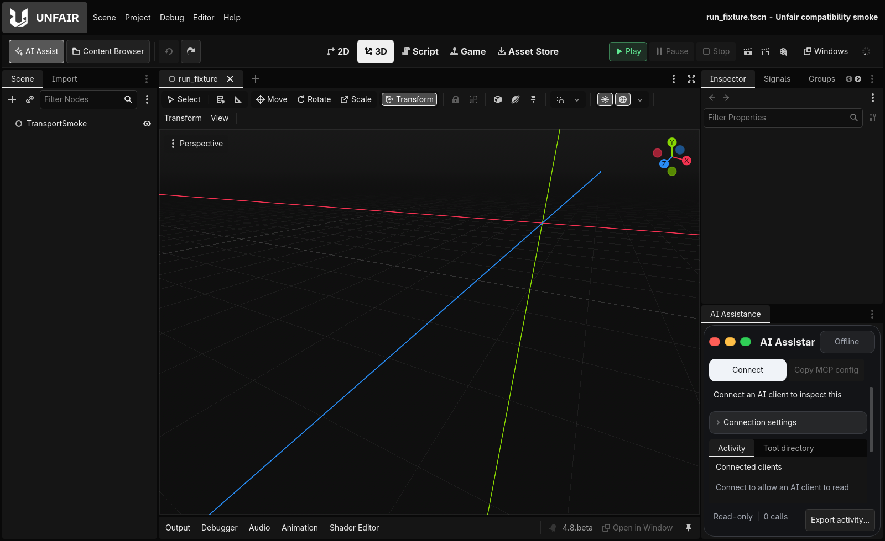
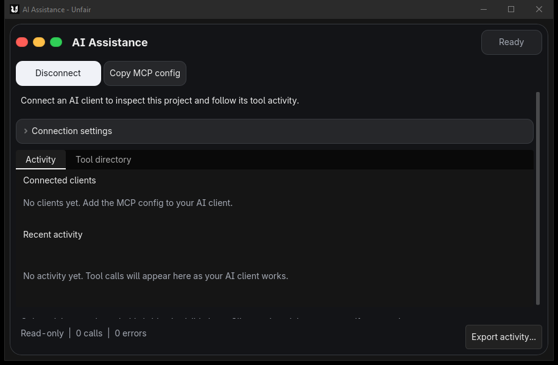
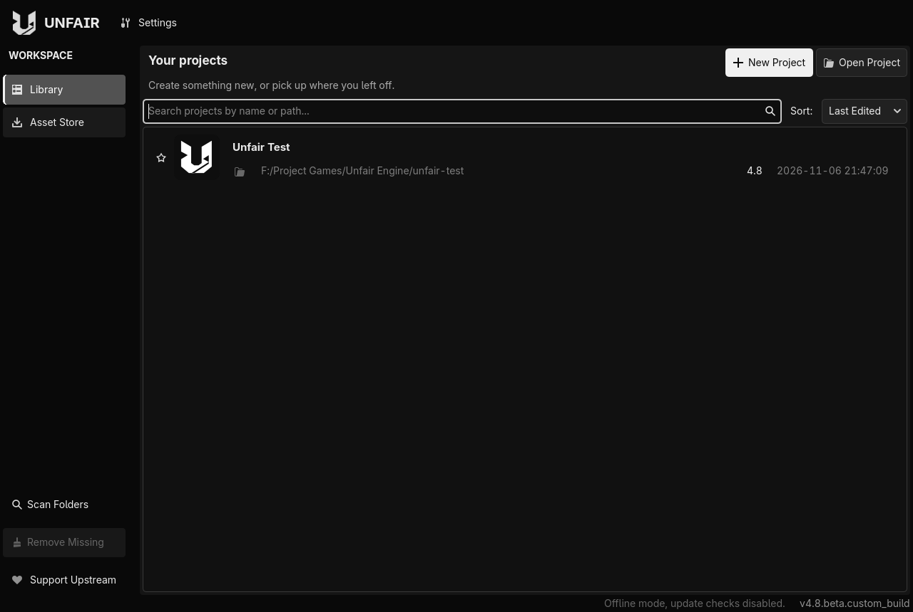
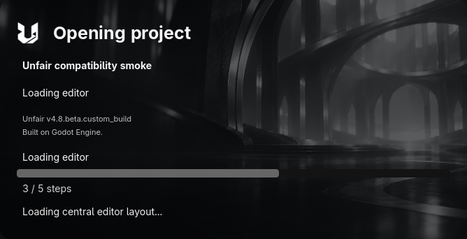

# Unfair Engine 4.8 Beta รุ่น 9 สำหรับ Windows x64

แพ็กเกจพร้อมติดตั้ง/แตก ZIP แล้วเปิดใช้ **ไม่ต้อง build source เอง**

| ไฟล์ | ใช้สำหรับ |
| --- | --- |
| [install.exe](https://github.com/reno0012x/Unfair-Engine/releases/download/v4.8.0-beta-unfair.9/install.exe) | ตัวติดตั้ง Unfair พร้อมตัวถอนโปรแกรมและ Python |
| [Unfair Portable](https://github.com/reno0012x/Unfair-Engine/releases/download/v4.8.0-beta-unfair.9/Unfair-4.8-beta-windows-x64-portable.zip) | แตกทั้งโฟลเดอร์แล้วเปิด `Unfair.exe` |
| [Unfair MCP](https://github.com/reno0012x/Unfair-Engine/releases/download/v4.8.0-beta-unfair.9/unfair-mcp-1.0.0-windows-x64.zip) | MCP 16 เครื่องมือ พร้อม Node และสคริปต์ติดตั้ง ถอน และตรวจระบบ |
| [คู่มือภาษาไทย](https://github.com/reno0012x/Unfair-Engine/releases/download/v4.8.0-beta-unfair.9/README-Windows-th.md) | วิธีติดตั้ง และเชื่อม MCP กับ Codex, Google Antigravity และ AI client อื่น |
| [SHA256SUMS.txt](https://github.com/reno0012x/Unfair-Engine/releases/download/v4.8.0-beta-unfair.9/SHA256SUMS.txt) | ค่า SHA-256 สำหรับตรวจไฟล์ดาวน์โหลด |

## ภาพจากโปรแกรมจริง

### Editor และแถบเครื่องมือ

ปุ่ม **AI Assist** และ **Content Browser** สูงเท่ากัน อยู่หน้า **Undo / Redo** บนแถบเดียวกัน สลับ 2D, 3D และ Script จากกลางแถบ และเปิดเครื่องมือในหน้าต่างแยกจากเมนู **Windows** ได้



### AI Assistance

ดูสถานะการเชื่อมต่อและประวัติการเรียกเครื่องมือผ่าน AI Assistance เปิดแท็บ **Tool directory** เพื่อดูเครื่องมือที่ใช้ได้ หรือ **Copy MCP config** เพื่อตั้งค่าใน AI client ภาพนี้แสดงสถานะ **Ready** ก่อนเชื่อมต่อ client



<details>
<summary>ดูภาพ Project Manager และหน้าโหลดโปรเจกต์</summary>

### Project Manager

ค้นหาจากชื่อหรือพาธ และสร้าง เปิด หรือสแกนหาโปรเจกต์จากหน้าคลังโปรเจกต์ธีมดำ



### หน้าโหลดโปรเจกต์

เห็นขั้นตอนที่กำลังโหลดผ่านแถบความคืบหน้า พร้อมภาพพื้นหลังของ Unfair และเครดิต Godot Engine



</details>

## วิธีติดตั้ง Unfair

เปิด `install.exe` แล้วเลือกโฟลเดอร์ ค่าเริ่มต้นคือ `%LOCALAPPDATA%\Programs\Unfair` เมื่อติดตั้งเสร็จให้เปิด Unfair จาก Start Menu หากต้องการถอนโปรแกรม ให้เปิด `Uninstall.exe` จากโฟลเดอร์ที่ติดตั้ง

## เชื่อม MCP กับ Codex

แตก ZIP ของ **Unfair MCP** เปิด PowerShell ในโฟลเดอร์ที่มี `install.ps1` แล้วรันคำสั่งนี้ โดยต้องมีคำสั่ง `codex` ใน PowerShell

```powershell
powershell -ExecutionPolicy Bypass -File .\install.ps1 -UnfairPath (Join-Path $env:LOCALAPPDATA 'Programs\Unfair\Unfair.exe')
codex mcp list
```

หากติดตั้ง Unfair ไว้ที่อื่น ให้ใช้พาธเต็มของ `Unfair.exe` ใน `-UnfairPath` เมื่อเห็น `unfair-engine` ให้ปิดและเปิด Codex ใหม่ แล้วลองสั่ง “ใช้ Unfair MCP ตรวจเวอร์ชันของ Unfair”

## เชื่อม MCP กับ Google Antigravity

ใช้ได้กับ **Antigravity App, Antigravity IDE และ Antigravity CLI** ที่รันในเครื่อง Windows ให้เพิ่ม `-Client Json` ในคำสั่งติดตั้ง MCP ข้างต้น แล้วนำรายการ `unfair-engine` จาก `client-config.json` ไปใส่ใน `mcpServers` ของ `mcp_config.json` โดยเก็บรายการเดิมไว้

ใน **Antigravity IDE** เปิดเมนู **… → MCP Servers → Manage MCP Servers → View raw config** ส่วน **Antigravity App** เปิด **Customizations → Installed → MCP Servers** แล้วใช้ **Copy Config File Path** ดูขั้นตอนของ CLI, Claude, Cursor, VS Code และการชี้ไปที่ Godot 4 ใน [คู่มือภาษาไทยฉบับเต็ม](https://github.com/reno0012x/Unfair-Engine/blob/main/Godot%20Engine/unfair/releases/README-Windows-th.md)

หากต้องการอ่าน Scene และ Node ที่กำลังเลือกใน Editor ให้เปิดโปรเจกต์ แล้วกด **AI Assist → Connect → Copy MCP config** ดูวิธีลงทะเบียนการเชื่อมต่อนี้และวิธีตั้งค่า AI client อื่นในคู่มือภาษาไทยด้านบน

## สิ่งที่มีในรุ่นนี้

- ธีม Unfair ดำ/ขาว, branding/loading artwork และเครดิต Godot
- AI Assist → Content Browser → Undo/Redo อยู่แถวเดียวกัน ขนาดปุ่มสอดคล้องกัน
- AI Assistance แบบโค้งมน มี connection/activity status และ advanced settings พับได้
- หน้าต่าง tools แยกได้ และรักษาการใช้ GDScript ตามเดิม

รุ่นนี้เป็น Developer Beta สำหรับ Windows x64 ที่ยังไม่ได้ลงลายเซ็นดิจิทัล
