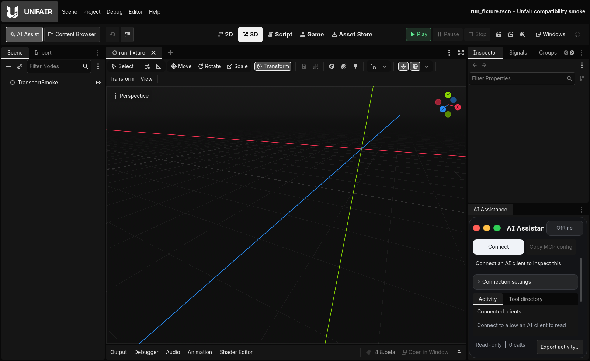
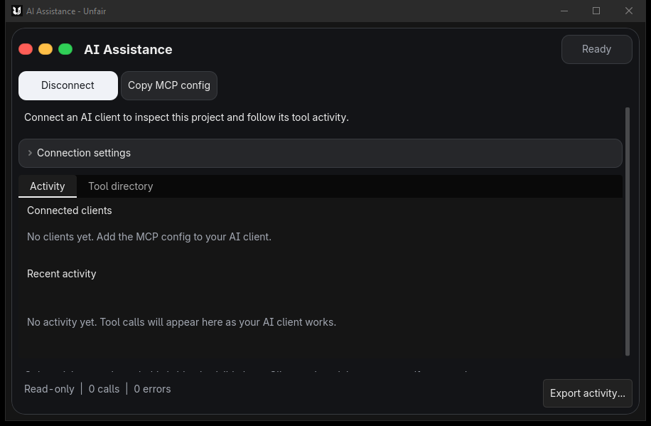
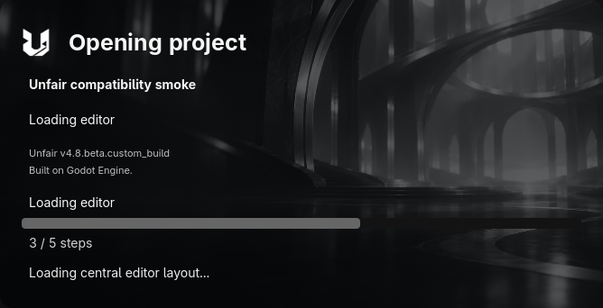

# Unfair Engine

Unfair เป็น fork ของ Godot Engine ที่ปรับแบรนด์และ Editor UI พร้อม AI Assistance,
MCP tools และเครื่องมือสร้างตัวติดตั้ง Windows โดยยังใช้ GDScript และรูปแบบโปรเจกต์
ของ Godot ตามเดิม

## ดาวน์โหลดไปใช้ได้เลย — Windows x64

**ไม่ต้อง build เอง:** เปิด [หน้า Releases](https://github.com/reno0012x/Unfair-Engine/releases/tag/v4.8.0-beta-unfair.9)
แล้วเลือกไฟล์ในตารางนี้

| ต้องการ | ดาวน์โหลด | วิธีใช้ |
| --- | --- | --- |
| ติดตั้ง Unfair พร้อมตัวถอนโปรแกรม | [install.exe](https://github.com/reno0012x/Unfair-Engine/releases/download/v4.8.0-beta-unfair.9/install.exe) | เปิด installer แล้วเรียก Unfair จาก Start Menu |
| แตก ZIP แล้วเปิดใช้ ไม่ต้องติดตั้ง | [Unfair Portable](https://github.com/reno0012x/Unfair-Engine/releases/download/v4.8.0-beta-unfair.9/Unfair-4.8-beta-windows-x64-portable.zip) | แตก ZIP ทั้งโฟลเดอร์ แล้วเปิด `Unfair.exe` |
| ให้ AI client ควบคุม Unfair ผ่าน MCP | [Unfair MCP พร้อม Node runtime](https://github.com/reno0012x/Unfair-Engine/releases/download/v4.8.0-beta-unfair.9/unfair-mcp-1.0.0-windows-x64.zip) | แตก ZIP แล้วใช้ `install.ps1` ตามคู่มือ |
| คู่มือติดตั้งและเริ่มใช้ | [README-Windows-th.md](https://github.com/reno0012x/Unfair-Engine/releases/download/v4.8.0-beta-unfair.9/README-Windows-th.md) | วิธีติดตั้ง, portable, MCP และถอนโปรแกรม |
| ตรวจไฟล์ที่ดาวน์โหลด | [SHA256SUMS.txt](https://github.com/reno0012x/Unfair-Engine/releases/download/v4.8.0-beta-unfair.9/SHA256SUMS.txt) | เปรียบเทียบด้วย `Get-FileHash -Algorithm SHA256` |

แพ็กเกจ Unfair มี EXE, DLL, รูป/asset, tools, licenses และ Python runtime ครบ
เป็นไฟล์และโฟลเดอร์ปกติ ส่วน MCP bundle มี Node และ dependencies พร้อมใช้
**อย่าดาวน์โหลดเฉพาะ `Unfair.exe` แยกไฟล์เดียว** และ ZIP “Source code” ของ GitHub
เป็นซอร์สสำหรับนักพัฒนา ให้เลือก Installer หรือ Portable หากต้องการเปิดใช้ทันที

รีโปนี้เป็น **Private** ผู้ดาวน์โหลดต้องล็อกอินบัญชี GitHub ที่มีสิทธิ์เข้าถึงรีโป
รุ่นนี้เป็น Windows x64 beta/developer build ที่ยังไม่ได้ code-sign

## ภาพโปรแกรมจริง

ภาพจากโปรแกรมและโปรเจกต์ทดสอบ ไม่ใช่ mockup; assets โลโก้และพื้นหลังที่ใช้ build
ถูกเก็บอยู่ใน source ด้วย

### Editor และ toolbar



### AI Assistance



### Loading โปรเจกต์



## โครงสร้างโปรเจกต์

- [`Godot Engine/`](<Godot Engine/>) — engine source รวม Editor, platform,
  modules, third-party libraries, tests และสคริปต์ build
- [`Godot Engine/unfair/`](<Godot Engine/unfair/>) — งานออกแบบ, branding/loading
  assets, validation และสคริปต์ build/QA ของ Unfair
- [`Godot Engine/unfair/ai/`](<Godot Engine/unfair/ai/>) — native AI Assistance
  MCP companion และคู่มือการเชื่อมต่อแบบอ่านข้อมูล
- [`Godot Engine/unfair/mcp/`](<Godot Engine/unfair/mcp/>) — Unfair MCP ที่ดัดแปลง
  จาก Coding-Solo/godot-mcp พร้อม source, tools ติดตั้ง/ถอน/ตรวจ และ build ZIP
- [`Godot Engine/unfair/installer/`](<Godot Engine/unfair/installer/>) — NSIS
  installer/uninstaller source และการทดสอบ
- [`ai-workflow/`](ai-workflow/) — สกิลและเครื่องมือแบ่งงาน/บันทึกสถานะ AI
- [`WORK_STATUS.md`](WORK_STATUS.md) — ประวัติงานและหลักฐานการตรวจสอบ

## Build บน Windows

ต้องมี Visual Studio C++ build tools/Windows SDK, Python และ SCons ที่รองรับ
Godot source รุ่นนี้ ดูรายละเอียด upstream ใน
[`Godot Engine/README.md`](<Godot Engine/README.md>) และเอกสาร build ของ Godot

```powershell
Set-Location 'Godot Engine'
.\unfair\build-windows.ps1 -Python python -Jobs 8
```

โปรแกรมที่ build แล้วอยู่ใน `Godot Engine/bin/Unfair.exe` สคริปต์ installer ใช้
NSIS 3.13 และ Python embeddable runtime ตามคู่มือ
[`unfair/installer/README.md`](<Godot Engine/unfair/installer/README.md>)

Unfair MCP ใช้ TypeScript/Node; source และ lockfile อยู่ใน
`Godot Engine/unfair/mcp/server/` ดู
[`คู่มือ MCP`](<Godot Engine/unfair/mcp/README-th.md>) และ
[`packaging`](<Godot Engine/unfair/mcp/packaging/README.md>) ก่อน build/ติดตั้ง

หน้า Code เก็บ source, รูปพรีวิว, assets และสคริปต์ ส่วนโปรแกรมที่ build แล้วพร้อม
runtime/dependencies ดาวน์โหลดได้จาก Releases ด้านบน Toolchains, caches,
QA exports และ connection config ส่วนตัวไม่ถูกอัปโหลด เอกสาร validation อ้างถึง
ผลทดสอบจากเครื่องพัฒนา; path ของผลลัพธ์ QA จะต้องสร้างใหม่เมื่อรันทดสอบ

## เครดิตและสิทธิ์ใช้งาน

Unfair Engine พัฒนาต่อจาก [Godot Engine](https://github.com/godotengine/godot)
ภายใต้ MIT license โดยเก็บ [`LICENSE.txt`](<Godot Engine/LICENSE.txt>),
[`COPYRIGHT.txt`](<Godot Engine/COPYRIGHT.txt>),
[`AUTHORS.md`](<Godot Engine/AUTHORS.md>) และ notices ของ third-party ไว้

Unfair MCP พัฒนาจาก [Coding-Solo/godot-mcp](https://github.com/Coding-Solo/godot-mcp)
ภายใต้ MIT license เช่นกัน ดู
[`server/LICENSE`](<Godot Engine/unfair/mcp/server/LICENSE>) และ
[`server/UPSTREAM.md`](<Godot Engine/unfair/mcp/server/UPSTREAM.md>)
